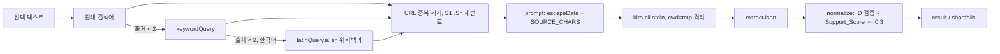

# Design Document

## Overview

제품 파이프라인(검증 -> 검색 -> 생성 -> 정규화)의 모양과 `src/core/service.js` 이벤트 계약은 그대로 두고, `src/ai/` 안의 각 단계를 보강한다. 검증 도구로 실측 스크립트, Kiro Hook, 개발용 MCP 서버를 더한다.

## Architecture

## Components and Interfaces

### search.js
- `keywordQuery(text, maxWords=4)`: `toQuery`로 정리한 뒤 조사(긴 것부터: 에서는, 으로는, 에서, 으로, 은, 는, 이, 가 ...)를 떼고, 2글자 미만, 숫자, 불용어를 뺀다. 등장 순서를 유지하고 중복을 없앤다.
- `latinQuery(text, maxWords=4)`: 라틴 문자로 시작하는 단어만 남긴다.
- `searchPlan(text, opts)`: `[{lang, query}]`. `opts.query`나 `opts.lang`을 주면 해당 단계 보강을 끈다.
- `searchTopic`: 계획 순서로 `searchOnce`를 부르고, `minSources`에 도달하면 멈춘다. 반환에 `attempts`(시도한 `lang:query`)를 추가했다. 서비스는 이 필드를 이벤트로 내보내지 않는다.

### prompt.js
- `escapeData(v)`: `& < > "` -> `&amp; &lt; &gt; &quot;`. `&`를 먼저 바꿔 이중 해석을 막는다.
- `SOURCE_CHARS = 1200`: 출처당 본문 상한. 튜닝 대상.
- `<question>`, `<direction>` 태그를 추가하고 규칙 문장에 데이터 태그로 명시했다.

### schema.js
- `bigrams(s)`: 소문자화 후 문자·숫자만 남기고 연속 2글자 집합을 만든다. 한국어는 조사가 붙어 단어 단위 비교가 어긋나므로 글자 단위를 쓴다.
- `supportScore(text, extract)`: `|bigrams(text) ∩ bigrams(extract)| / |bigrams(text)|`.
- `sourceIndex(sources)`: ID 집합과, 본문이 있는 출처의 `bigrams(title + extract)` 색인.
- `sourceRefs(ids, index, text)`: 존재하는 ID이면서(본문이 있으면) 점수가 `SUPPORT_MIN` 이상인 ID만 남긴다.

### providers/kiro.js
- `isolatedCwd()`: `os.tmpdir()/conversation-cheatsheet-kiro`를 만들고 반환한다. V3 headless는 작업 폴더의 `.kiro/`, `AGENTS.md`, hooks를 읽기 때문이다.
- `timeoutMs`: 옵션 -> `KIRO_TIMEOUT_MS` -> 120000. 1000 미만이나 숫자가 아니면 무시한다.

### scripts/measure-kiro.js
- 예시 주제 3개(짧은 명사, 긴 한국어 문장, 영어 혼합) x `--runs`. 출력은 행마다 숫자 JSON, 마지막에 요약.

### Kiro 도구
- `scripts/hooks/lib.js`: `classifyShell`, `findSecrets`, `ownershipDecision`, `testTargets` 등 판단 로직(순수 함수).
- `.kiro/hooks/*.json`: 위 스크립트를 PreToolUse, PostFileSave, SessionStart, PostCompact, Stop, PreTaskExec, PostTaskExec, PostFileCreate에 연결한다.
- `scripts/mcp/cheatsheet-mcp.js`: stdio JSON-RPC MCP 서버. 도구 `wiki_search`, `build_prompt`, `verify_result`, `support_score`, `offline_preview`, `project_status`.

## Correctness Properties

### Property 1: 어떤 선택 텍스트에서도 프롬프트의 `</selected_text>`는 정확히 하나다.

**Validates: Requirements 2.1, 2.2**

### Property 2: 정규화 결과의 모든 sourceId는 검색된 ID이고, 본문이 있으면 그 본문과의 Support_Score가 SUPPORT_MIN 이상이다.

**Validates: Requirements 4.1, 4.4, 4.6**

### Property 3: `basis: sourced`인 문장은 sourceIds가 비어 있지 않다.

**Validates: Requirements 4.2**

### Property 4: 검색 결과 sources의 URL은 서로 다르고 ID는 S1부터 연속이다.

**Validates: Requirements 3.3**

### Property 5: 첫 요청이 네트워크 오류면 fetch는 정확히 한 번 호출된다.

**Validates: Requirements 3.4**

## Error Handling

- 검색: 네트워크 오류는 `failed`, 결과 없음은 `insufficient`, 취소는 `AbortError` 전파.
- 생성: kiro-cli 없음(ENOENT)은 설치 안내 메시지, 비정상 종료는 종료 코드와 stderr 앞 200자, 시간 초과는 프로세스 종료 후 오류.
- 정규화: 잘못된 JSON 모양은 예외 없이 빈 결과와 `shortfalls`.

## Testing Strategy

- `test/ai/prompt.test.js`: 구분자 탈출, 모든 데이터 필드 이스케이프, `SOURCE_CHARS` 상한.
- `test/ai/search.test.js`: 가짜 fetch 라우터로 단계별 재검색, 병합, 실패, 부분 실패, 취소.
- `test/ai/schema.test.js`: Support_Score 경계, 강등, 다중 출처 선별, 오프라인 회귀.
- `test/ai/providers.test.js`: 작업 폴더 격리, 머리말 섞인 출력, 타임아웃 설정·종료.
- `test/hooks/`, `test/mcp/`: Hook 판단 함수와 스크립트 종료 코드, MCP 프로토콜 왕복.
- 실제 Kiro 응답은 단위 테스트에서 부르지 않고 `scripts/measure-kiro.js`로 따로 잰다.
