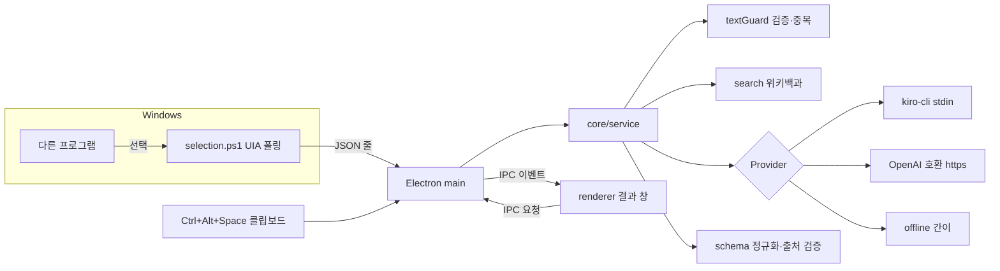

# Design Document

## Overview

Electron(메인 프로세스 + 샌드박스 렌더러) 기반 Windows 데스크톱 앱이다. 핵심 로직은 Electron에 의존하지 않는 순수 Node 모듈(`src/core`)로 분리해 단위 테스트한다. 선택 텍스트 감지는 PowerShell UI Automation 헬퍼가 담당하고, 응답 생성은 교체 가능한 Provider 인터페이스로 추상화한다. PRD가 Kiro 직접 연동 가능 여부를 확정하지 않았으므로 Kiro CLI, OpenAI 호환, 오프라인 간이 모드를 모두 지원한다.

## Architecture

## Components and Interfaces

- `core/textGuard`: `validateInput(raw, max)`, `createDedupe(windowMs)`.
- `ai/search`: `searchTopic(text, {fetchImpl, signal})`가 `{status: ok|insufficient|failed, sources[], retrievedAt}`를 반환한다.
- `ai/prompt`: 선택 텍스트와 자료를 구분자 태그로 감싼 프롬프트를 만든다.
- `ai/schema`: 모델 JSON 추출 및 정규화. 존재하지 않는 출처 ID 제거, 질문에 `estimated` 부여, 부족분 `shortfalls` 계산.
- `core/service`: `analyze`, `retry`, `changeTone`, `regenerate`, `followup`, `cancel`. 요청 ID로 오래된 응답을 폐기한다.
- `ai/providers/*`: `generate({prompt, signal, ctx, kind})`가 문자열(JSON)을 반환한다.
- `main/*`: 창, 트레이, 단축키, 설정, 선택 감지 프로세스, IPC 검증(`event.sender` 확인).
- `renderer/*`: `textContent` 기반 DOM 렌더링, CSP 적용.

## Data Models

- Session(메모리 전용): `{text, tone, note, direction, sources[], searchStatus, result, topicHint}`.
- Result: `{topic, keyFacts[], statements[], questions[], topicSwitches[], shortfalls[]}`.
- Settings(디스크): `{autoAnalyze, consentAccepted, tone, provider}`만 저장한다.

## Error Handling

- 검색 실패는 `failed`로 표시하고 생성은 계속하되 출처 없는 내용은 `general`로만 표시한다.
- 생성 실패, JSON 파싱 실패는 `retryable` 오류로 알리고 재시도 시 검색 성공분은 재사용한다.
- 취소된 요청(AbortError)은 조용히 폐기한다.

## Correctness Properties

### Property 1: 어떤 입력에서도 `validateInput`이 ok이면 결과 텍스트는 비어 있지 않고 1500자 이하다.

**Validates: Requirements 1.2, 1.3**

### Property 2: 모델이 어떤 sourceIds를 내놓아도 정규화 결과의 sourceIds는 검색된 출처 ID의 부분집합이다.

**Validates: Requirements 9.5**

### Property 3: 출처가 없는 항목은 `basis: sourced`가 될 수 없다.

**Validates: Requirements 2.3, 9.5**

### Property 4: 새 분석이 시작된 뒤에는 이전 requestId의 이벤트가 emit되지 않는다.

**Validates: Requirements 8.3**

### Property 5: 창 위치 보정 결과는 항상 작업 영역 안에 있다.

**Validates: Requirements 7.5**

## Testing Strategy

Node 내장 테스트 러너로 core와 main 순수 모듈을 단위 테스트하고, `npm run smoke`로 실제 Electron 창에서 위키백과 검색과 렌더링까지 종단 흐름을 확인한다. `npm run check`는 위험 패턴 정적 점검을 수행한다.