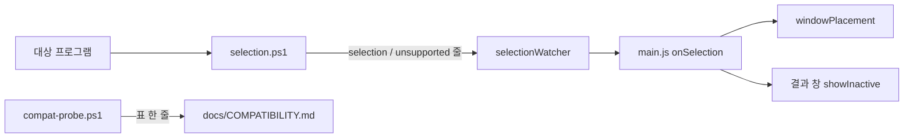

# Design Document

## Overview

감지 흐름은 그대로 PowerShell UI Automation 폴링을 유지하고, 측정과 설정, 미지원 상태 보고, 창 배치 보정을 추가한다. 실측 결과 폴링이 부족한 경우에만 이벤트 기반으로 바꾸는 방안을 검토한다. 이번 범위에서는 구현하지 않는다.

## Architecture

## Components and Interfaces

- `selection.ps1`: 인자 `-IntervalMs`, `-StableCount`. 마우스는 50ms 주기로 샘플링하고, 드래그가 포커스된 컨트롤 영역 안에서 시작했을 때만 미지원을 보고한다. 버튼 교체 설정을 따른다. 출력은 JSON 한 줄이며 `{"type":"selection","text","pid"}` 또는 `{"type":"unsupported","pid","proc"}`다. 하위 호환을 위해 `type` 없는 줄은 selection으로 취급한다.
- `selectionWatcher`: `parseLine`이 두 종류를 구분해 `onSelection`, `onUnsupported`를 호출한다. 설정값은 인자로 전달한다.
- `windowPlacement`: `placeWindow(cursor, size, workArea)`는 크기가 작업 영역보다 크면 작업 영역 크기로 제한한 뒤 배치한다.
- `main.js`: 미지원 프로세스를 이름 기준으로 한 번만 안내한다. 안내 문구에 선택 텍스트와 창 제목을 쓰지 않는다.
- `scripts/compat-probe.ps1`: 3초 뒤 포커스된 요소를 한 번 읽어 표 한 줄을 출력한다.

## Data Models

- 감지 메시지: `{type, text?, pid, proc?}`. `text`는 메모리에서만 쓰고 저장하지 않는다.
- 측정 행: `| 프로그램 | 버전 | 감지 | 지연(초) | 비고 |`.

## Error Handling

- 헬퍼 프로세스가 종료되면 상태를 갱신하고 앱은 대체 경로를 안내한다.
- 파싱 실패 줄과 과도하게 긴 버퍼는 버린다.

## Correctness Properties

### Property 1: 배치 결과는 항상 작업 영역 안에 있다

**Validates: Requirements 4.1, 4.2**

### Property 2: 미지원 상태 메시지와 진단 출력에는 선택 텍스트가 포함되지 않는다

**Validates: Requirements 3.3, 6.1, 6.2**

### Property 3: 잘못된 줄은 어떤 입력에서도 예외 없이 무시된다

**Validates: Requirements 2.4**

## Testing Strategy

`selectionWatcher`와 `windowPlacement`는 Node 테스트로 검증한다. 난수 입력으로 Property 1~3을 확인한다. 실제 프로그램 감지는 `npm run compat`으로 사람이 측정하고, `npm run smoke`와 패키징된 exe 스모크로 종단 흐름을 확인한다.