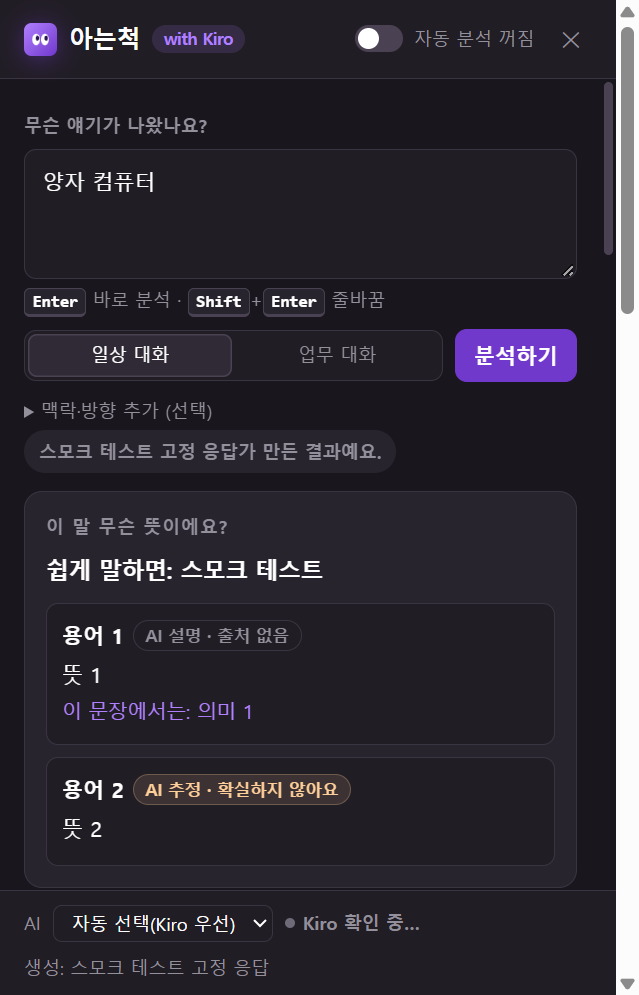

# 대화 치트키

낯선 주제가 대화에 등장했을 때, **텍스트를 드래그하기만 하면** 바로 쓸 수 있는 문장과 예상 질문 답변, 자연스러운 화제 전환 문장을 보여주는 Windows 데스크톱 대화 보조 앱입니다.

- Demo: 로컬 실행 앱입니다(배포 URL 없음). 시연 영상 링크: _(녹화 후 여기에 추가)_
- 화면 예시: [docs/assets/screenshot.png](docs/assets/screenshot.png)



## 문제 정의

- 회의, 수업, 일상 대화에서 모르는 주제가 나오면 검색하는 사이 대화 흐름을 놓칩니다.
- 설명을 찾아도 "그래서 뭐라고 말하지?"가 남고, 상대가 되물으면 다시 막힙니다.
- 화면에서 소재를 발견해도 복사, 다른 서비스 열기, 붙여넣기 과정이 번거롭습니다.

## 핵심 기능

| 기능 | 내용 |
|---|---|
| 선택 즉시 분석 | UI Automation으로 선택한 텍스트만 읽어 작은 결과 창을 띄웁니다 (비밀번호 입력란 제외) |
| 근거 있는 정보 | 위키백과를 검색하고 출처명, 링크, 확인 시점을 표시합니다. 검색 실패 시 사실처럼 꾸미지 않습니다 |
| 아는 척 문장 5개+ | 일상/업무 말투 선택, 문장별 복사와 부분 재생성 |
| 예상 질문 5개+ x 답변 2개+ | "AI 추정" 표시, 질문별 답변 복사 |
| 화제 전환 3개+ | 방향을 직접 지정할 수 있습니다 |
| 실제 후속 질문 | 받은 질문을 입력하면 기존 주제와 말투를 유지해 답변 생성 |
| 수동 대체 경로 | 붙여넣기 입력, 클립보드 분석 단축키 `Ctrl+Alt+Space` |

## 사용 시나리오

1. 팀 회의 중 채팅창에 "RAG"라는 말이 올라옵니다. 단어를 드래그합니다.
2. 결과 창이 뜨고 출처와 함께 "바로 쓸 문장"이 가장 위에 나옵니다. 복사해서 대화에 씁니다.
3. 상대가 "도입하면 뭐가 좋아요?"라고 물으면 후속 질문 칸에 입력해 답변 후보를 받습니다.
4. 이야기를 돌리고 싶으면 화제 전환 문장을 고릅니다.

## 기대 효과

- 검색, 정리, 문장화를 한 번의 드래그로 줄여 대화 흐름을 유지합니다.
- 출처와 "AI 추정" 표시로 아는 척이 거짓말로 번지지 않게 합니다.
- 선택 내용을 저장하지 않고 자동 전송하지 않아 안심하고 켜 둘 수 있습니다.

## 차별점

- 단순 요약이 아니라 **말할 문장 + 예상 질문 + 화제 전환**까지 한 화면에 제공합니다.
- 모델이 만든 출처는 믿지 않고 검색된 출처 ID만 허용하는 **사실 검증 계층**이 있습니다.
- AI 공급자를 교체할 수 있어(Kiro CLI, OpenAI 호환, 오프라인 간이 모드) Kiro 연동 가능 여부와 상관없이 동작합니다.

## 설치와 실행

요구 사항: Windows 10/11, Node.js 20 이상.

```bash
npm install
# electron 설치 스크립트가 차단된 환경이라면:
node node_modules/electron/install.js
npm start
```

처음 실행하면 창이 열리고 트레이 아이콘이 생깁니다. 창 오른쪽 위 스위치로 자동 분석을 켜면 동의 안내가 표시됩니다.

### AI 공급자 설정

| 공급자 | 설정 | 비고 |
|---|---|---|
| Kiro CLI | `kiro-cli` 설치 후 `KIRO_API_KEY` 환경 변수 설정 (`KIRO_CLI_PATH`로 경로 지정 가능) | `kiro-cli chat --v3 --no-interactive`를 stdin 프롬프트로 호출. 서비스용 사용 허용 여부는 규정 확인 필요 |
| OpenAI 호환 | `CHEAT_LLM_BASE_URL`, `CHEAT_LLM_API_KEY`, `CHEAT_LLM_MODEL` | https 또는 localhost만 허용 |
| 오프라인 간이 | 설정 없음 | 검색된 자료 문장을 인용하는 제한적 품질. 외부 AI 전송 없음 |

창 하단에서 공급자를 직접 고를 수 있고, "자동 선택"은 Kiro, OpenAI 호환, 오프라인 순으로 사용합니다.

### 검증 명령

```bash
npm test          # 단위 + 속성 기반 테스트 (57개)
npm run check     # 보안 정적 점검
npm run smoke     # 실제 Electron 창에서 검색~렌더링 종단 확인 (네트워크 필요)
npm run pdf       # PRESENTATION.pdf 재생성
npm run dist      # 휴대용 exe 빌드 (electron-builder)
```

### 알려진 제한

- 자동 선택 감지는 대상 프로그램이 UI Automation `TextPattern`을 제공해야 동작합니다. 안 되는 프로그램에서는 붙여넣기 또는 `Ctrl+Alt+Space`를 사용하세요. 시연 대상별 실측은 필요합니다.
- 검색은 위키백과 기반이라 최신 뉴스성 주제는 부족할 수 있습니다. 부족하면 화면에 표시합니다.

## 문서

- 명세: `.kiro/specs/conversation-cheatsheet/` (requirements, design, tasks)
- 보안 검토: [docs/SECURITY_REVIEW.md](docs/SECURITY_REVIEW.md)
- Kiro 활용 기록: [BUILD_REPORT.md](BUILD_REPORT.md)
- 원본 PRD: [PRD.md](PRD.md)